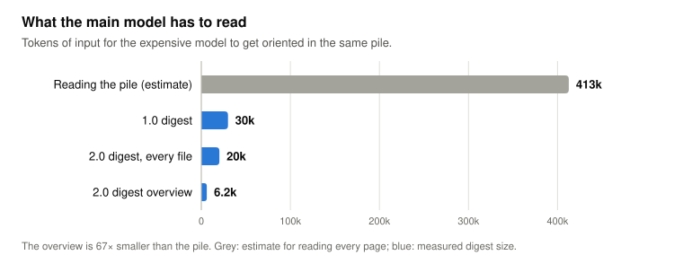
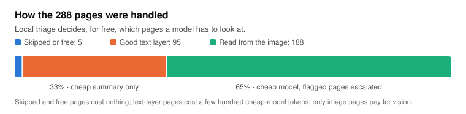
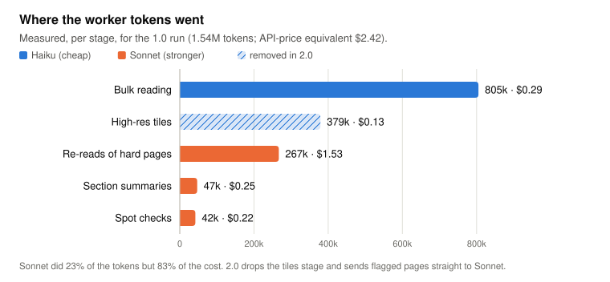
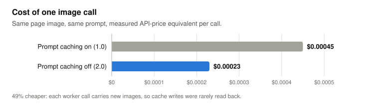

# pile-digest

[](https://github.com/devesh8090/pile-digest/actions/workflows/ci.yml)
[](LICENSE)


**A Claude Code skill that lets Claude understand a big, messy pile of documents without using up your usage window.**

It works on lecture slides, scanned or handwritten notes, book chapters, reports, manuals, Office files, photos of whiteboards, and zip files of all of the above. Point pile-digest at the folder and Claude reads it, checks it and understands it, and tells you what's in it and what's wrong with it.

That's where the skill stops. Asking questions, making notes or anything else is up to you, and Claude serves those requests from what it now understands.

Free local tools do everything they can, a cheap model does the bulk reading, and the expensive model spends its tokens only where they pay off.

```
/pile-digest ~/Downloads/semester-dump
```

---

## Why

Reading hundreds of pages with the most capable model is slow and expensive, and most of that spending is waste:

| Waste | What pile-digest does instead |
|---|---|
| Blank pages, repeated title slides and duplicate pages read like any other page | Detected locally from low-resolution renders and text hashes, and skipped for free |
| Typed pages sent as images although their text layer is fine | The text layer is used directly; at most, a cheap model writes a one-line summary |
| Long-lived subagents re-read their growing context every turn, so cache reads grow quadratically | Every batch is a **fresh single-turn** `claude -p` call: no tools, a short cached system prompt, images inlined once |
| The expensive model reads full transcriptions just to find its way around | It reads a **digest** of about 40 tokens per page (outline, page summaries, flags) and opens full pages only where needed |
| Hard pages read at the same level as easy ones | A **ladder**, for flagged pages only: a stronger model (which corrects the cheap reading rather than starting over), then the main model |

## In numbers

These come from one real field run on a 288-page pile: 11 PDFs, including two handwritten notebooks (107 pages), five slide decks and typed notes. The worker figures were measured by the 1.0 pipeline's own ledger. The 2.0 digest was rebuilt from the same results. The raw numbers are in [`docs/stats/data.json`](docs/stats/data.json), and `python3 docs/stats/make_charts.py` redraws the charts.

| | |
|---|---|
| Pages | **288**: 5 skipped or free, 95 from text layers, 188 read from images |
| Worker spend | **1.65M tokens**, $2.63 API-price equivalent (about **$0.009 per page**), including the pilot |
| Main model's map of the pile | **6.2k-token** digest overview (20k with every per-file page list), instead of an estimated **413k** to read the pile itself |
| Main-model page reads | 25 page images opened during review, out of 288 |
| Source errors found | **22**, each recorded with how it was checked |

<p align="center"></p>

<p align="center"></p>

<p align="center"></p>

<p align="center"></p>

**What 2.0 changed because of these numbers:**
- **Tiles stage removed.** It used about a quarter of the tokens and resolved few handwritten pages.
- **Prompt caching off.** One image call now costs about half as much.
- **Smaller digest.** It is split so the overview fits in a single read.
- **Spend cap.** Spend is capped at 1.25× what you approved.

Handwriting-heavy piles cost more than typed ones, because more pages need the stronger model. A pile of clean slides or scans sits much nearer the cheap end.

## Careful, not just cheap

A wrong transcription of a formula is worse than none, so the pipeline is built to surface doubt rather than hide it:

- **No guessing.** The bulk model must never complete, derive or "fix" anything. Unreadable parts become `[[ILLEGIBLE: best guess?]]`, doubtful ones `[[UNSURE: …]]`, and apparent errors in the source `[[SOURCE-SUSPECT: …]]`.
- **Measured accuracy.** A stronger model audits a random sample of each reading level against the page images. A mismatch sends the page to the review queue with a suggested correction. If one level's error rate is high, you're told which one.
- **Re-reads can't make things worse.** A higher-level reading that shares almost nothing with the earlier reading, or with the page's own text layer, is rejected and handed to the main model.
- **Verification is part of the job.** Source documents contain errors too: wrong constants, garbled formulas, contradictions between files. The main model:
  - recomputes worked examples;
  - checks every flagged claim and records a verdict;
  - compares pages in different files that share the same numbers.

  Confirmed errors are listed separately from transcription errors.

## Cost before work

Nothing is spent without your go-ahead:

1. **`prepare`** (free): inventories, converts and triages the pile, then shows a token estimate. This covers pages skipped, pages free, pages that need vision, tokens per model, and how much the main model will read compared with reading everything.
2. **`pilot`** (small): the cheap model reads a sample, chosen to include the hardest pages, and the estimate is re-calibrated from the real usage. The CLI reports how full your 5-hour window is, so the pilot can also project roughly what share of the window the full run needs.
3. **`approve`, then `run`:** the run stops by itself, and asks again, if spend passes the approved amount by more than 25%. It also stops before your window fills (configurable). Everything finished is saved per page, and the next `/pile-digest` resumes where it stopped.

**Rough cost per page:**
- **Typed, scanned or slide page that needs vision:** about 1.2–1.6k input and 0.6k output tokens on the cheap model.
- **Text-layer page:** a few hundred cheap-model tokens for its summary, or nothing.
- **Handwriting:** costs several times more, because many pages need the stronger model. On one real 288-page pile with two handwritten notebooks, version 1.0 averaged about 5.7k tokens per page. Version 2.0 cuts the main waste behind that.
- **The main model:** reads about 40 tokens per page of digest, plus whatever it opens.

`pd.py ledger <pile>` shows the real numbers for each stage and model.

## It keeps track of your piles

- **Registry:** every pile you add is remembered, and `/pile-digest` with no argument reports what changed since last time.
- **Watch folders:** every new subfolder becomes a pile automatically (`pd.py watch add ~/Documents/piles`).
- **Incremental runs:** only new or changed files are processed. Renamed or moved files keep their results (documents are keyed by content hash), and moved pile folders are found again.
- **Later sessions:** Claude gets back up to speed on a pile by reading its digest, which always reflects every fix and verdict, not by re-reading the pile.

## Anything goes in

| Input | How it's handled (best installed tool first, then a fallback) |
|---|---|
| PDF | poppler (text layer, rendering, image detection) · qpdf/mutool/Ghostscript repair · bookmarks become the outline · encrypted files are unlocked by you, privately |
| Images (PNG, JPEG, WebP, GIF, TIFF incl. multi-page, BMP, HEIC, AVIF, JP2, SVG…) | Pillow or ImageMagick (orientation, scaling, tiling) · sent as they are if no library is present |
| Word, PowerPoint, Excel, ODF | LibreOffice → PDF (layout kept) · or pure-Python XML text plus embedded images |
| EPUB, HTML, RTF, Markdown, LaTeX, code, CSV, Jupyter notebooks | standard-library parsers; embedded images go to vision |
| Email (.eml, .mbox) | body as text, attachments processed like any other file |
| Archives (zip, tar, gz, bz2, xz, 7z, rar) | unpacked recursively with zip-bomb, path-traversal and depth limits |
| DjVu, PostScript/EPS, XPS | converted with ddjvu, ps2pdf or mutool when installed |
| Audio, video, unknown binaries, password-protected archives | listed with the reason and the fix, never dropped silently |

## Install

**Requirements:** [Claude Code](https://claude.com/claude-code), Python ≥ 3.9 and `poppler-utils`. Everything else is optional.

| Optional tool | Adds |
|---|---|
| qpdf, mutool, Ghostscript | PDF repair, bookmarks, spotting drawings on typed pages, PostScript |
| LibreOffice | Office files with full layout; legacy `.doc`/`.ppt`/`.xls` |
| Pillow or ImageMagick | odd image formats, tiling of image files |
| 7-Zip | 7z and rar archives |
| sympy | algebra checks during verification |

**As a personal skill** (gives `/pile-digest`):
```sh
git clone https://github.com/devesh8090/pile-digest.git
cd pile-digest && ./install.sh          # symlinks skills/pile-digest into ~/.claude/skills
```

**As a plugin:**
```
/plugin marketplace add devesh8090/pile-digest
/plugin install pile-digest@pile-digest
```
Plugin skills are namespaced, so the command becomes `/pile-digest:pile-digest`; Claude also triggers the skill on its own when you ask it to digest a folder of documents.

Then check your setup:
```sh
python3 ~/.claude/skills/pile-digest/scripts/pd.py doctor          # add --live to test the CLI login with one tiny call
```

## Use

In Claude Code:
```
/pile-digest                       # what's new or changed across your piles
/pile-digest ~/path/to/folder      # start with a specific folder
```
Claude walks you through it:
1. summary and estimate;
2. pilot;
3. your approval;
4. run (in the background for big piles);
5. review and verification;
6. a short brief of what the pile contains and what's wrong with it.

It asks before spending anything. After that, ask whatever you like about the material.

Everything is also available on the command line (`pd.py --help`), for scripting or for inspecting state yourself.

## Privacy

The pages that need reading are sent through your own Claude Code login. Pages the local triage skips are never sent. State lives in `~/.local/state/pile-digest/`, and `pd.py forget <pile> --yes` removes it. Your files are never modified. Private names, ID numbers and contact details on pages (e.g. a notebook cover) are redacted in transcriptions. See [SECURITY.md](SECURITY.md).

## Documentation

- [`SKILL.md`](skills/pile-digest/SKILL.md): the workflow Claude follows
- [`references/pipeline.md`](skills/pile-digest/references/pipeline.md): stages and state layout
- [`references/cost-model.md`](skills/pile-digest/references/cost-model.md): how estimates work
- [`references/quality.md`](skills/pile-digest/references/quality.md): the verification checklist
- [`references/config.md`](skills/pile-digest/references/config.md): every setting
- [`references/troubleshooting.md`](skills/pile-digest/references/troubleshooting.md): problems and fixes

## Development

```sh
python3 -m unittest discover -s tests -v    # a fake `claude` binary stands in for the CLI: no network, no cost
```
See [CONTRIBUTING.md](CONTRIBUTING.md).

## License

[MIT](LICENSE)
